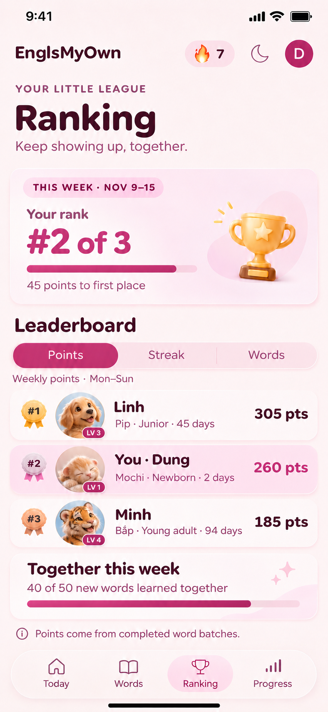
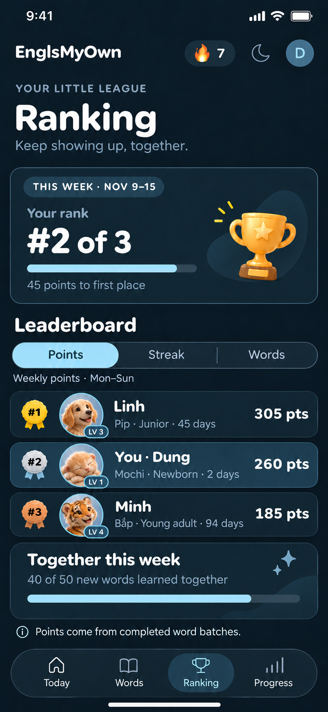
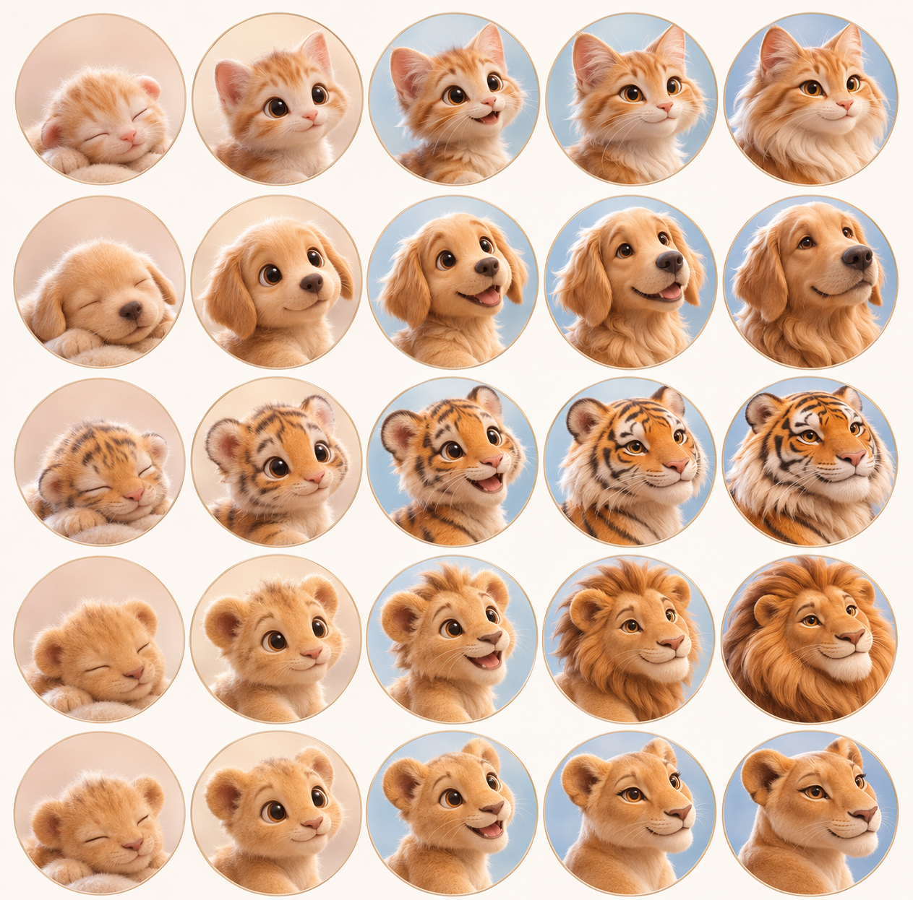

# Ranking pet avatars · design v1

These are the approved visual references for the live Ranking avatars.

## Preview

| Light                               | Dark                              |
| ----------------------------------- | --------------------------------- |
|  |  |

The stage board has five columns from left to right: **Newborn, Baby, Junior, Young adult, Adult**. Its rows from top to bottom are **cat, dog, tiger, male lion, lioness**. The same character keeps recognizable features as it matures. The Young adult and Adult portraits change silhouette, coat and facial features, rather than only growing larger.

## Avatar treatment

- Use a dedicated close-up portrait for Ranking; the full-body animated pet art remains for Today and pet interactions. The face occupies most of a 56–64 pt circular avatar so it reads on iPhone.
- A small `LV 1`–`LV 5` pill overlaps the lower-right rim without covering the face. Light mode uses the established plum accent; dark mode uses ice blue.
- The row shows the human display name, then `Pet name · Stage · N days`. Age is the pet's calendar age, separate from weekly learning days or streak.
- The samples show Pip (Junior, 45 days, LV 3), Mochi (Newborn, 2 days, LV 1) and Bắp (Young adult, 94 days, LV 4). Names, ages and points are illustrative. The age samples are compatible with the app's current calendar-age growth ceiling, but do not establish a new growth formula.
- The badge level is the existing five-stage index plus one. This design does not introduce a second XP/level system.

## Implementation

The same 5 × 5 portrait board is encoded as `public/assets/pets/ranking-avatars-v1.jpg` for the live page. The Ranking UI crops the matching cell at runtime by appearance and growth stage. The full-body animated pet art remains for Today and pet interactions. A paw appears if the portrait cannot load.

The approved-user ranking summary includes the chosen pet name and calendar age derived from the first completed batch day. Older summaries remain readable until their owner next opens the app; their pet name and age are omitted in the meantime. Email and detailed learning records stay private. The level pill maps to the five existing growth stages.

## Image generation direction

The avatar board prompt asked for a five-by-five grid of premium soft 3D head-and-shoulders portraits with consistent individual identity across stages, close framing, warm catchlights, rounded friendly expressions and visibly different Young adult/Adult silhouettes. The two Ranking edits used the existing Points light/dark mockups as layout targets and the board as portrait reference. Only leaderboard rows were redesigned; the rest of the screen follows the agreed Ranking v2 design. The light mockup received one targeted age-label correction from 35 to 45 days.
