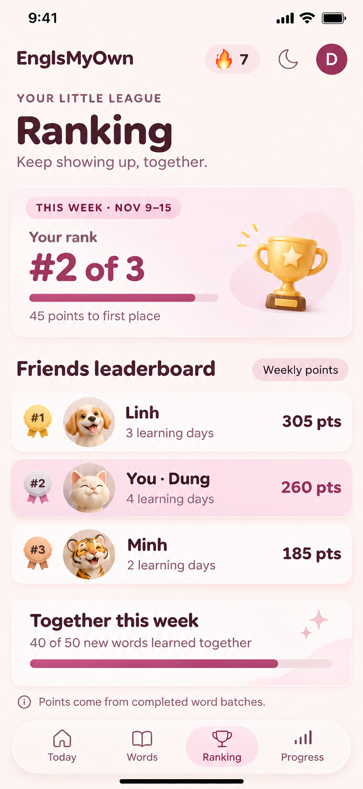
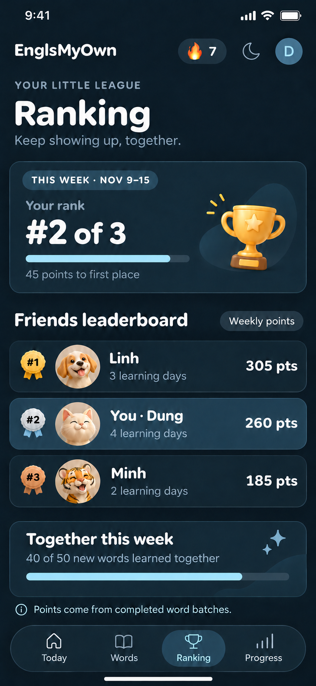

# Ranking tab · mobile concept v1

This is an image mockup for review, not an implemented screen. It proposes replacing the Videos tab with Ranking while keeping Today, Words, and personal Progress. Videos can return later as a separate feature.

## Concept

- A private, friendly weekly league for the approved learners using the app.
- Put the learner's current place and the gap to the leader first; show the full small-group leaderboard directly below.
- Show each member's chosen pet as a small avatar, with the current learner highlighted. Display name, learning days, and points are visible; email is not.
- Add an optional shared word goal below the competitive list. The sample shows 40 of 50 new words, consistent with completed 10-word batches.
- Keep the existing floating glass navigation, safe areas, typography direction, and light/dark palettes. In both themes the third tab reads Ranking, with a trophy icon.

The names, scores, date, and group goal are illustrative. The point formula is **not yet approved**. A recommended rule is to award points only when a review or new-word batch is saved as complete, never for repeated attempts or simply leaving a timer running. The week would run Monday–Sunday in Vietnam time; personal lifetime history remains in Progress.

## Interaction notes for implementation later

- The selected learner row stays visually distinct, even when their rank changes.
- The top progress bar is the learner's points divided by the current leader's points, capped at 100%; 260/305 is about 85% in the example.
- The group-goal bar is 40/50, or 80%. The group goal is motivational and does not gate streaks, reviews, or access to new words.
- The page reads only approved learners' public profile fields and derived weekly totals. It never exposes Google email addresses.
- Empty and single-member states, ties, long names, and laptop layout need their own review before coding.

## Imagegen prompt set

Built-in Imagegen generated the light screen and transformed it into a matching dark screen. The final prompt specification was:

> High-fidelity straight-on iPhone 17 Pro Max app screenshot for EnglsMyOwn. Design a clean English-language Ranking tab for a private three-person learning league. Preserve a warm cream/light-blush theme and a midnight-navy/ice-blue dark variant. Header: brand, streak, theme, avatar. Heading: Ranking and “Keep showing up, together.” Feature card: “THIS WEEK · NOV 9–15”, “Your rank”, “#2 of 3”, “45 points to first place”, a gold trophy, and an 85%-filled progress bar. List: Linh with dog, 305 pts; You · Dung with cream cat, 260 pts; Minh with tiger, 185 pts. Highlight the current user. Group card: “Together this week”, “40 of 50 new words learned together”, 80%-filled progress bar. Footer note: “Points come from completed word batches.” Floating glass navigation: Today (home), Words (book), Ranking (trophy, selected), Progress (bar chart). Rounded Nunito-style headings, DM Sans-style body text, large tap targets, iPhone safe areas. Same layout and sample data in both themes. No Vietnamese, no green, no neon, no phone frame or presentation board.

The dark variant used the light design as a reference and changed only theme colors; follow-up image edits corrected navigation icons, progress proportions, and the group-goal copy.
