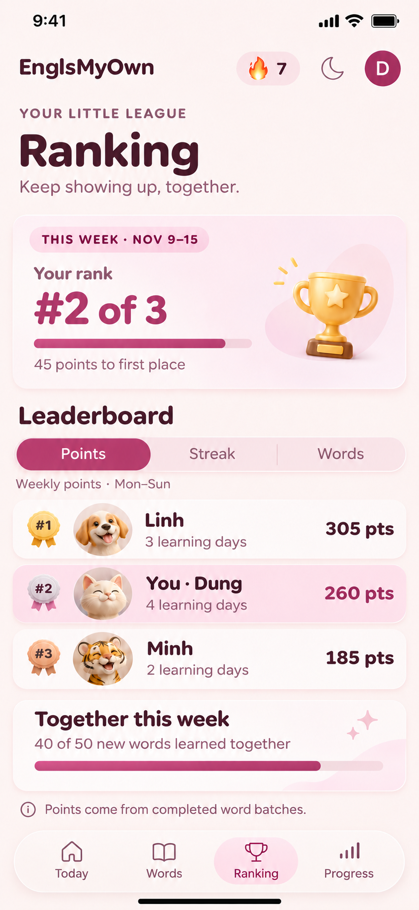
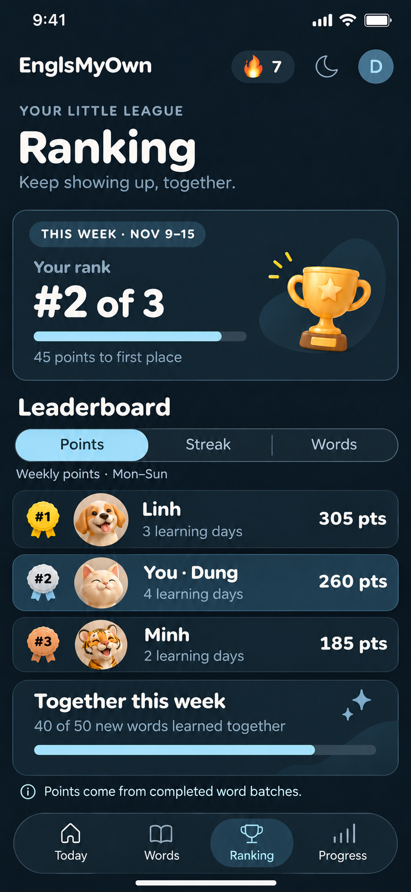
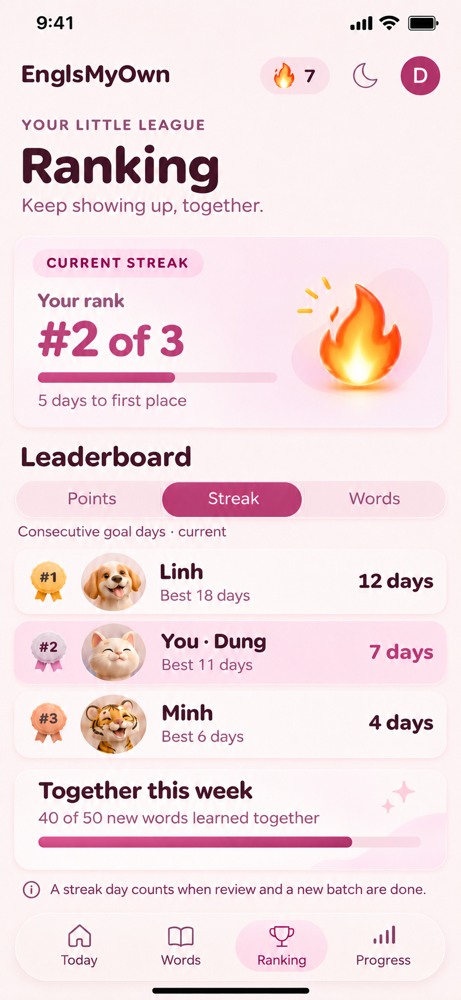
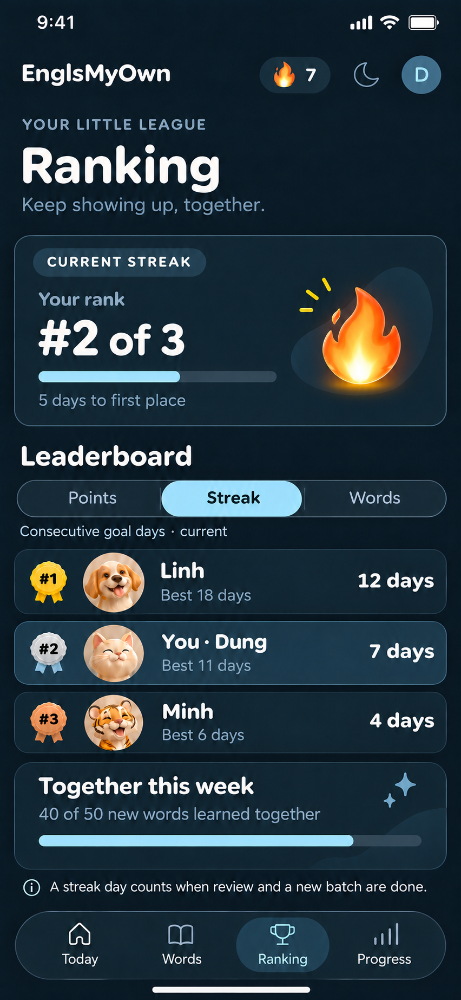
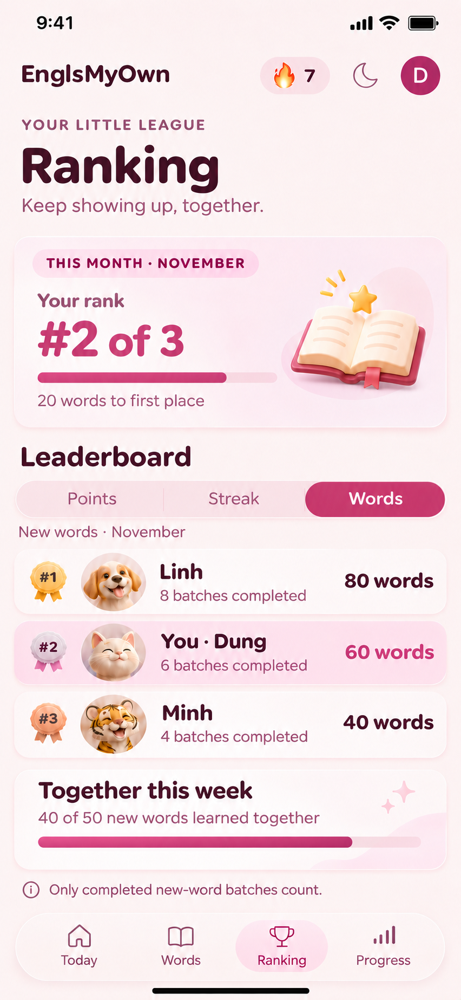
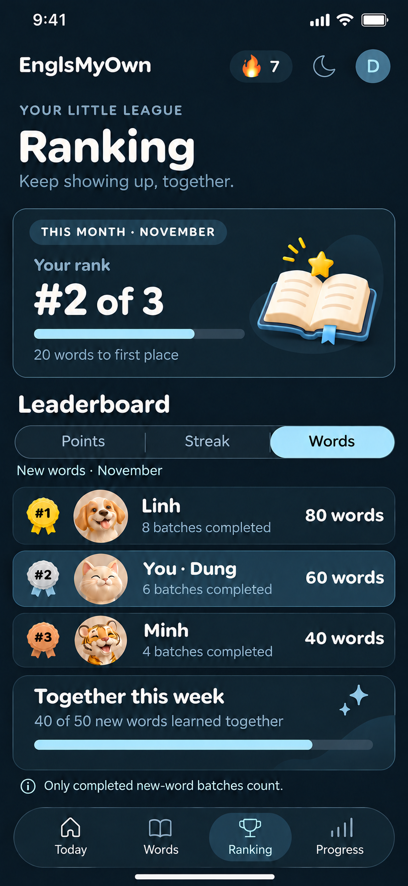

# Ranking tab · three metrics · mobile concept v2

These are image mockups for design review. No Ranking UI, score calculation, or shared leaderboard has been implemented yet. This iteration extends [v1](../ranking-v1/README.md) with a segmented metric switch.

| Metric | Light | Dark |
| --- | --- | --- |
| Weekly points |  |  |
| Current streak |  |  |
| New words this month |  |  |

## Metric definitions proposed for the app

- **Points**: ranking for the current Monday–Sunday week in Vietnam time. The sample values 305 / 260 / 185 are illustrative. Set and approve the point formula before implementing. Award points from completed, saved learning activity; do not award them from retries, idle time, or simply opening a screen.
- **Streak**: rank by the *current* consecutive goal days. This should use the existing `streak()` rule in `src/lib/model.ts`: a goal day requires all required review and at least one completed new-word batch. The counter continues through today if today's goal is complete, otherwise through yesterday. Personal best is shown beneath each name as context, but is not the ranking criterion.
- **Words**: rank by new words learned during the current calendar month in Vietnam time. With the current fixed batch size, each completed new-word batch contributes ten words. Review batches do not add new words. The example 80 / 60 / 40 words corresponds to 8 / 6 / 4 batches.

The top card, selected segment, helper line, rankings, and gap to the leader all change together. The shared weekly word goal stays the same across tabs. Top progress bars represent the current user's value divided by the leader's: about 85% for points (260/305), 58% for streak (7/12), and 75% for words (60/80). The group bar represents 40/50, or 80%. Sample names, pet portraits, counts, and dates are illustrative.

## Interaction and data notes

- Default to **Points**; switching metrics should preserve scroll position and animate the segment and changed numbers gently. Respect reduced-motion settings.
- The points ranking resets on Monday at 00:00 Vietnam time; the words ranking resets on the first day of a month. Current streak has no periodic reset. Show the exact period in the UI.
- Ties should share a rank. When everyone has zero, avoid a misleading progress bar or gap-to-leader message. Handle a one-person league and long names during implementation.
- Show only an approved learner's chosen display name, pet avatar, and derived public ranking totals. Do not expose email addresses, raw learning records, or Firestore document IDs in the leaderboard.
- The shared goal is encouragement only; it does not gate study or affect streaks. Its 50-word target and point formula need product approval before coding.
- Only the mobile appearance is shown. Desktop layout and actual tap targets, scrolling, animation, and data loading will be verified when this feature is implemented.

## Imagegen direction

The v1 light/dark screens were used as references. Each v2 screen retains EnglsMyOwn typography, warm cream and plum light theme, navy and ice-blue dark theme, rounded cards, pet avatars, and the iOS-style floating glass navigation. The edits add an equally sized **Points · Streak · Words** segmented control and switch the metric-specific hero, values, labels, and icon. Follow-up edits corrected the hero-bar proportions and changed the dark Words book cover to blue. English remains the UI language.
